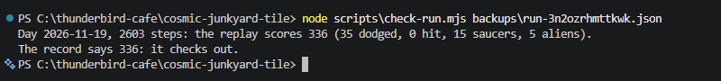

import CosmicJunkyardDemo from '../../components/CosmicJunkyardDemo.astro';

[Cosmic Junkyard](/blog/cosmic-junkyard-tile) got an update. Dice still fall out of the sky, and you still walk left and right to dodge them. But the game now has sounds, it plays as your own [rpg.actor](https://rpg.actor/) character when you're signed in to [Raku](https://raku.lexicographer.space/), and at the end of a run it can create a record of that run for your account.

The character part is simpler than before. In [the first Cosmic Junkyard post](/blog/cosmic-junkyard-tile), you typed your handle under the game and the page fetched your sprite from your account. In Raku there's nothing to type: if you're signed in, Raku finds your character in rpg.actor's Compendium (one tile that holds every rpg.actor character) and hands it to the game.

Here's the game. This page's player shows it, and still offers the handle search, but it doesn't save runs:

<CosmicJunkyardDemo uri="at://did:plc:6vxjigxrqizmbo56gojxico3/ing.dasl.masl/3mwvoqidyqd24" />

To save a run, **[play it in Raku](https://raku.lexicographer.space/#t=at%3A%2F%2Fdid%3Aplc%3A6vxjigxrqizmbo56gojxico3%2Fing.dasl.masl%2F3mwvoqidyqd24&a=0)**.

## A sealed game that hands over its own record

A web tile is sealed: it has no network and no sign-in, and it can't write anything anywhere. So how does a run end up in your account?

The game makes the record itself. When a run ends and you press **Save this run**, Cosmic Junkyard puts together a small record (your score, the day's course, when you played, what you dodged and caught) and hands it to Raku, with the name of the collection it belongs in. Raku then:

1. checks that the record really comes from Cosmic Junkyard's own tile, and that it's exactly the kind of record that collection holds, field by field;
2. adds the two things the game can't vouch for: which game made it, by its address and exact version, and when it was saved;
3. asks you;
4. writes it to your account.

That's new in this series. In [Seven-Up](/blog/seven-up), the player's tile just asked the page to save, and the page built the record itself from the referee tile's result. The page had to understand Seven-Up. Here the game writes its own record, and Raku only has to know what a valid one looks like.

![Two rows of boxes. Seven-Up: the player tile asks to save, saying “save, please”; the page builds the record from the result; your account keeps it. Cosmic Junkyard: the game tile makes the record, highlighted as new, and passes the record to Raku; Raku checks it, adds the game's address and version, and asks you; your account keeps it. Both “Your account” boxes sit inside a dashed outline labelled “The network”, which only the page and Raku reach. A line underneath: the tile still can't write anything itself; it has no network and no sign-in.](../../assets/cosmic-junkyard-record.png)

It's a bit like the difference between asking someone to send in a form for you and handing them the form already filled in. They don't need to know how to fill it in, only how to check it's done properly. That's what lets the same path work for more games: each brings its own kind of record, and the host checks it and delivers it.

![Screenshot of Raku's window with Cosmic Junkyard open in its own tab, the game dimmed behind a prompt that reads: Save this run to @thunderbird.cafe? This adds a public record to @thunderbird.cafe's account (a Cosmic Junkyard run record and nothing else). It shows your score (199), the day's course (2026-11-19) and when you played. It includes your moves (46 changes of direction), so anyone can replay the run to check its score. Below: What will be saved, Use another account, and three buttons, Allow once, Always and No.](../../assets/cosmic-junkyard-prompt.png)

Raku's prompt says what will be added and offers **Allow once**, **Always** (for that account and game, in this browser) or **No**. The tile never sees your sign-in; Raku does the writing. When it's done, the game says so:


**See it** opens the record, a `cafe.thunderbird.cosmicjunkyard.run` in your own repo. Here's one of mine, in PDSls:

![Screenshot of PDSls showing the record: PDS fibercap.us-west.host.bsky.network, repo thunderbird.cafe, collection cafe.thunderbird.cosmicjunkyard.run, record 3n2ozrhmttkwk. The record: $type cafe.thunderbird.cosmicjunkyard.run, createdAt, day 2026-11-19, game with its cid and its uri (the Cosmic Junkyard tile's address), then moves: the first change at step 154, go right, then a note that 75 more changes are skipped here, then frame height 48 and width 48, steps 2603; playedAt; score 336; tally: aliens 5, dodged 35, hit 0, saucers 15.](../../assets/cosmic-junkyard-pdsls.png)

As text:

```json
{
  "$type": "cafe.thunderbird.cosmicjunkyard.run",
  "game": {
    "uri": "at://did:plc:6vxjigxrqizmbo56gojxico3/ing.dasl.masl/3mwvoqidyqd24",
    "cid": "bafyreife6ymswem3e2dlcbl5474g7yamfxxcsxo6k26pchpqxc4oqurgvq"
  },
  "score": 336,
  "day": "2026-11-19",
  "playedAt": "2026-11-19T21:36:57.580Z",
  "tally": { "dodged": 35, "hit": 0, "saucers": 15, "aliens": 5 },
  "moves": {
    "frame": { "width": 48, "height": 48 },
    "steps": 2603,
    "changes": [{ "at": 154, "go": "right" }, { "at": 167, "go": "stop" }, …]
  },
  "createdAt": "2026-11-19T21:37:21.890Z"
}
```

## Runs anyone can check

A score on its own proves nothing: anyone could write a record that says 10,000. So on the save screen there's a box, **Include my moves so this run can be checked**, off unless you tick it.

With it ticked, the record also holds your moves: every change of direction, by step (the game runs 60 steps a second), plus the size of your character, which sets how big a target you are. Every player gets the same course on a given day, so those moves, played again on that day's course, give exactly the same run.

And the record names the exact version of the game that played it. A web tile's version is its content address, so a replay can run the very same code, not just something with the same name. Anyone can do it with the replay script in [the game's repo](https://github.com/pyxorium/cosmic-junkyard-tile):

```
node scripts/check-run.mjs run.json
```

Here's that run of mine (the 336 above), checked:



A check that passes shows that this score came from these moves, on that day's course, in that version of the game. So it catches a made-up score, a run claimed for a different day, and a changed copy of the game. What it can't tell you is who or what pressed the keys: a perfect run played by a program would check out too.

## Play right in a tile post

Raku has [tile posts](/blog/tile-posts): posts that carry a live tile you can play in place. Cosmic Junkyard works there just as it does in its own tab. Press **Play here** on its post, and you get your character, and **Save this run** at the end. The game's end screen is small at post size, so **Expand** makes it comfortable. Raku's prompt comes up over the whole window, and from **Full screen**, Raku steps out of full screen to ask.


**[Open Tile posts in Raku](https://raku.lexicographer.space/#t=raku%3Adiscover%2Fposts&a=0)** to find it.

## What's public

Your saved runs live in your own account, and like other records there, they're public: they show your score and roughly when you played. Ticking "Include my moves" adds the moves themselves, which is what lets anyone replay the run and check the score; leave it unticked and the record holds just your score. Nothing is saved until you press Save.

## For game developers

[The game's repo](https://github.com/pyxorium/cosmic-junkyard-tile) has a README written for you: the messages both ways, the record and its lexicon, the replay script, and how to do the same in your own game.

The messages are small and travel over the Tiles Protocols data channel, the same one the character uses:

- The game says `hello`. A host that can save its runs answers `can-save`, naming the collection.
- **Save this run** sends `write-record`, with an id, the collection and the record.
- The host answers with its status (`asking`, then `saving`) and a result: `ok` with the record's address and the account's handle, or why not (`declined`, `not-allowed`, `invalid`, `failed`).
- **See it** sends `open-record` with that address.

A game that hears nothing back simply never shows the save button, so it still works in any other host.

Raku's rules, as it stands today:

- Only Cosmic Junkyard's own tile, any version of it, may save into its collection; a copy published somewhere else isn't told it can save.
- Only new records. Raku keeps only the game's own fields, checks each one, and fills in `game` and `createdAt` itself.
- At most 20 saves per load, one at a time. Signing in to Raku covers saving game runs, along with its other permissions.

One honest caveat: Raku isn't fully general yet. It keeps a list of the games it accepts, with a copy of each game's record check. A new game means a new collection, a line in that list, and one more approval when you sign in.

## What's next

More games. Over time, more web tile games will come into Raku much the way Cosmic Junkyard did, each saving its own runs to your account.
