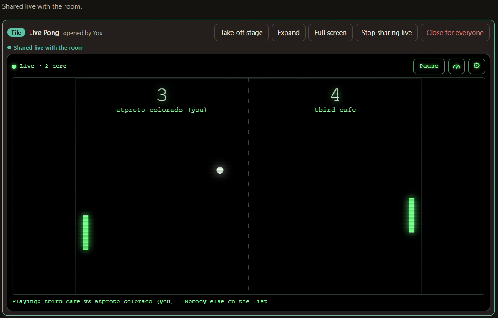
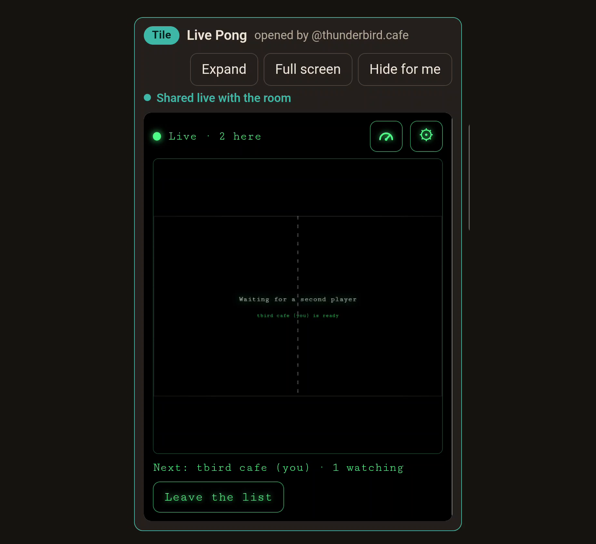

import LoopVideo from '../../components/LoopVideo.astro';
import JobsTable from '../../components/JobsTable.astro';

Until now, the live tiles in Raku rooms did things like a poll: someone votes, and a moment later every screen shows it. A second's delay doesn't matter to a poll. Pong is the opposite. The ball is always moving, and a game only works if both players see it in the same place at nearly the same time.

This game was written to find out. **Live Pong** is a single web tile that lets two people play Pong at the same time, each on their own screen, in a [Raku](https://raku.lexicographer.space/) room.

## A room, in three sentences

A room in Raku is a small live call: voice, one shared screen, and tiles opened for everyone. A tile shared live runs as its own copy on every screen, and the copies pass small messages to each other, directly between the computers. The [Rooms post](https://thunderbird.cafe/blog/rooms) has the rest.

## Playing

Open Live Pong in a room and press **Share live**. Everyone in the room now has their own copy of the game.

Tap **I'd like to play** and type a short name. The first two on the list play, first to 7; anyone else watches and gets the next turn. After a game, tap again to rejoin the list. Opened on its own, outside a room, Live Pong plays against the computer.

On a computer you play with the arrow keys (or W and S); on a phone, with your thumb on the court.





## What it looks like

Here is one rally, recorded on both screens at once: a computer hosting the room and a phone joining it.

<LoopVideo src="/blog/live-pong/live-pong-rally.mp4" poster="/blog/live-pong/live-pong-rally-poster.png" alt="Two screens playing the same rally of Live Pong, a computer above and a phone below. Each screen shows its own player on the left, so the two courts are mirror images. Captions: “Two players, each on their own screen: each copy shows its player on the left.” “Each player's copy calls their own hits…” “…and the other screen waits a moment for that call.”" width={800} height={1230} />

Your own paddle moves the moment you do. The other player's paddle glides along a moment behind, and the score is the same on every screen. Each player sees themselves on the left, so the game names players, not sides: "tbird cafe serves".

*(Each device recorded its own screen. The computer's recorder made its half stutter, so that half has been smoothed; the hits and their timing are as played. The phone's half is as recorded.)*

## Did it work?

Yes, two people can share one web tile in real time. It was played on Wi-Fi and on mobile data, with a computer hosting and with a phone hosting, and with two guests playing while the host watched. The room never refused a message.

Live Pong is a proof of concept, not a finished game. Your own paddle answers instantly, but now and then the ball pauses for a moment at the other player's paddle before it comes back. That's the game waiting to hear from the other screen. How long it waits depends on the connection between the two players: usually a few hundredths of a second in the tests, so often too short to see, sometimes long enough to notice. The numbers, and some known ways to smooth it out, are below, for builders.

It's also a game for friends: each player's own copy calls their own hits, so it runs on trust. More on that below too.

## Seeing the speed

The small gauge button above the court shows one line under it: the round trip to the other copies and back, how many paddle updates are arriving each second, and whether the room has had to slow anything down. It covers nothing, so you can play with it on. Tap the line for the details: below the court on a phone, over the right side of the court on a computer.


**Come try it.** Open [Live Pong in Raku](https://raku.lexicographer.space/#t=at%3A%2F%2Fdid%3Aplc%3A6vxjigxrqizmbo56gojxico3%2Fing.dasl.masl%2F3mzl5yvfay72f&a=0) to play the computer, or start a room with a friend, put it on the stage and share it live.

## For builders

### The numbers

Each player's copy measures its own round trip: a small message out through the room and back. The host's copy always shows a few milliseconds, since the room's hub runs on its own device.

<JobsTable>

| Game | Measured on | Typical round trip | Worst |
| --- | --- | --- | --- |
| Computer hosting, phone guest, Wi-Fi | the phone | 70 ms | 117 ms |
| Two phones playing, the computer hosting, Wi-Fi | phone 1 / phone 2 | 54 ms / 23 ms | 70 ms / 37 ms |
| Phone hosting, computer guest, Wi-Fi | the computer | 57 ms | 161 ms (one spike) |
| Computer hosting, phone guest on mobile data | the phone | 51 ms | 62 ms |

</JobsTable>

These come from a handful of devices over two days, not a survey. Paddle updates went out at 10 a second, and no copy was ever slowed by the room's limits.

### No referee

There is no referee copy. The room puts every live message into one order, and every copy runs the same pinned tile and sees the same messages in the same order. So every copy reaches the same score, the same list and the same result without anyone announcing it, just as every copy of the poll reaches the same count.

The ball doesn't stream. It travels as events: a serve, then each hit. From each event every copy works out the ball's whole path, bounces off the side walls included, and draws it in between. The only steady stream is each player's own paddle, at most 10 updates a second, which the other copies draw a little behind so it glides instead of jumping.

Each player's own copy calls their own hits and misses, because only that copy knows exactly where its paddle was when the ball arrived. So lag can make the other paddle look a little soft, but it never costs anyone a point.

### The wait at the far paddle

On the other screens, the ball waits at a player's paddle until that player's call arrives. That wait is the round trip between the two players, plus a screen frame or so at each end: one hop each way when a guest plays the host, two each way when two guests play (every message goes through the host's page).

The ball doesn't then hurry to catch up. Each run of the ball starts on a screen when its message arrives there, so the player who must hit next always gets the ball's whole run to react. Catching up would have taken that time away from them.

### Trust

Players call their own shots, so someone could change the tile in their own browser and claim hits they missed. Pinning the tile stops a room from running a different tile; it doesn't stop a person tampering with their own copy.

A game can be built so that changing your own copy gains nothing. [Daisy](https://thunderbird.cafe/blog/daisy/) does it for dice with commit-reveal rolls, and [Seven-Up](https://thunderbird.cafe/blog/seven-up/) with a house tile that referees. For Pong, a referee on another computer could decide every hit from the paddle positions it receives. A referee wouldn't need to wait for the far player's call, so the ball would flow without pausing, but its paddle positions are always a little old, so it would sometimes call a miss on a player who hit the ball on their own screen.

Live Pong chooses trust: rooms are for friends, and when connections lag, trust feels fairer.

### Smoothing it out

Live Pong waits for each player's own call, so every call is fair and no screen shows anything that didn't happen; the cost is the occasional pause at the far paddle. Networked games have long dealt with this kind of delay, and builders use a range of known techniques, for example:

- **Prediction:** each screen guesses what happens next (say, that the ball bounces off a paddle that's in place) and corrects itself if the guess was wrong.
- **Interpolation and easing:** drawing motion between updates so that pauses and corrections look gentler.
- **A referee with lag compensation:** one copy decides every hit, judging each player by what their screen showed a moment earlier.
- **Shorter paths:** connecting players more directly, so messages travel less far.

Each has its own trade-offs, and none of them has been tested here. Whether one or more would suit live tiles is open for further experiments. Live Pong is offered as it is: a proof of concept that shows two people can share one web tile in real time, any noticeable delay and all.

### The paddle rate and the room's limit

Rooms allow each copy 10 messages a second (with short bursts of 30). The tile keeps its own count of that allowance and holds back paddle updates before it runs out, so a serve or a hit is never refused. At 5, 10 and 20 paddle updates a second, the round trip stayed the same, and above about 10 the room's limit flattens the difference (the tile simply holds the rest back). So 10 a second is enough for Pong, and no faster lane was needed.

### Measuring

**Copy numbers**, in the details, puts the readout into a few plain lines to paste into a chat; that's how the numbers in the table above were gathered. Here's what it gave on a phone playing as a guest on mobile data, with the computer hosting:

```
Live Pong numbers
Role: playing; 2 here
Round trip: typical 51 ms, worst 62 ms (last 20)
Paddle updates arriving: 0.0 a second (last 2 s)
Paddle rate setting: 10 a second; sent 0.0 a second (last 2 s); held back 0
Room limits: 0 (rate 0, room 0, other 0)
This game: 129 messages; paddle updates sent 112, arrived 0; busiest second 0 arriving
```

("Arrived 0" because the other paddle stood still that game: updates go out only while a paddle moves.)

To feel a slower network on one computer, rooms-lab's dev page takes `?livedelay=100`: it holds every live message that many milliseconds before passing it on, with the room's real hub and limits otherwise unchanged. It's on the dev page only, never in Raku.

### Where it came from

Live Pong's look and rules come from the Pong on the [Thunderbird Café Station](https://thunderbird.cafe/webtiles/station/): the green phosphor court, the dashed net, the glowing paddles, first to 7, the ball speeding up with each return. Its room parts grew from the live poll in the [Rooms post](https://thunderbird.cafe/blog/rooms). The code is in [rooms-lab](https://github.com/pyxorium/rooms-lab/tree/main/tiles/pong), in `tiles/pong/`.

## Further reading

**Tiles**

- [dasl-tiles](https://tangled.org/robin.berjon.com/dasl-tiles), Robin Berjon: the web tiles spec, on Tangled.
- [Webxdc specification](https://docs.webxdc.org/spec/index.html): small apps shared in a chat, whose copies send each other updates; the model live tiles follow.

**From this blog and its code**

- [Rooms: sharing web tiles inside a browser](https://thunderbird.cafe/blog/rooms): rooms in Raku and the live poll.
- [Raku: a browser for web tiles](https://thunderbird.cafe/blog/raku/): the browser rooms live in.
- [Daisy: a web tile game with a lounge where players find each other](https://thunderbird.cafe/blog/daisy/): commit-reveal dice between two computers.
- [Seven-Up: a referee tile between two player tiles](https://thunderbird.cafe/blog/seven-up/): a house tile that referees.
- [Thunderbird Café Station](https://thunderbird.cafe/webtiles/station/): home of the original Pong tile.
- [rooms-lab](https://github.com/pyxorium/rooms-lab): the rooms code, with Live Pong in `tiles/pong/`.
