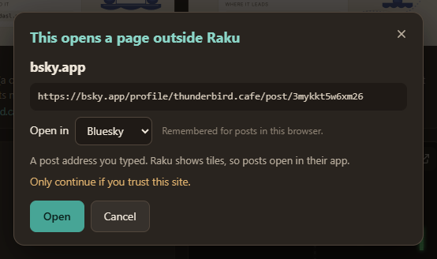
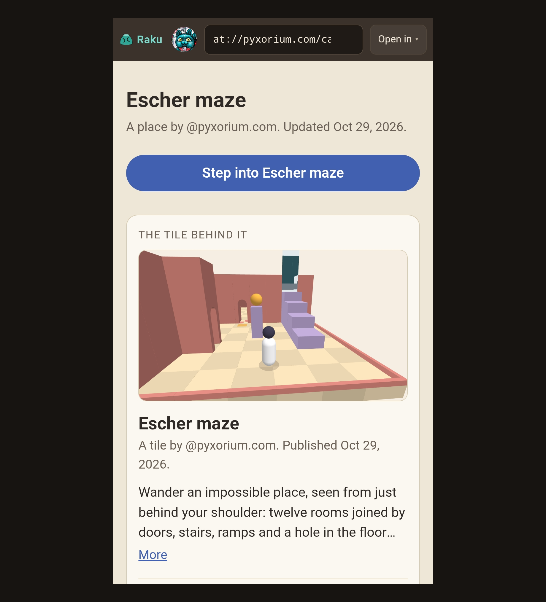
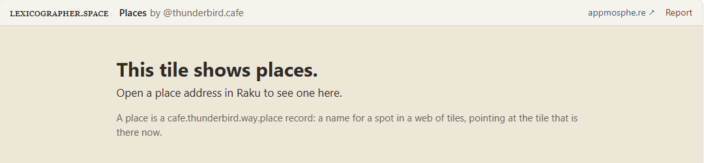

import Enlarge from '../../components/Enlarge.astro';

[Raku](https://raku.lexicographer.space/) is a browser for web tiles. Until this week it could only show tiles. Anything else you gave it, a post, a place, a signpost, it handed off to some other app. Now a record can open in a Raku tab too, drawn by a tile written to show that kind of record. These are referred to as **renderer tiles**. This post covers how that came about, the first two renderers, and, for builders, exactly how Raku hands a record to one.

## Part 1: what you can do now

### The address box learns links

It started with the address box. Raku's box used to take web tile addresses and atproto accounts. As of Nov 5, it takes any AT URI, and it recognises links pasted from the places where AT URIs usually turn up: PDSls (on both `pdsls.dev` and `pds.ls`), Taproot, webtil.es, and Bluesky-style profile and post links from any app. A pasted link turns into the AT URI behind it and opens as if you'd typed that.

Not everything opens inside Raku. A post goes to its own app:



Any other kind of record used to get a similar message, with a choice of record explorers (PDSls or Taproot): **"Raku doesn't show … records yet."** That last word was the plan.

### "Yet": renderer tiles

A renderer tile is an ordinary web tile, published like any other, whose job is to draw one kind of record. When you open a record in Raku, Raku looks at its kind, checks its list of renderers, and if one is pinned for that kind, runs it in a tab and hands it the record. Raku does the handing over with a protocol from the tiles spec itself, so the same renderer could work in any other host that speaks it.

The first renderer is **Places**. A place is a small record from [the ways I built for the Escher maze and Winter Forest](https://thunderbird.cafe/blog/ways-portal-loop/): a name, and a pointer to the tile that is there right now. A tile's own address changes every time it's republished (the maze moved accounts entirely, from one server to another server, in October), but a place's address stays put and is simply pointed at the new tile. So a place address is the one worth sharing, and now it's worth opening:


The postcard shows the place's name and who made it, a **Step into** button that opens the tile in a new tab, and the card of the tile behind it: its banner, name and description, read for it by Raku. **Open in ▾** next to the address box shows the raw record in an explorer. On a phone it fits the narrow screen:



[Open the maze's place in Raku](https://raku.lexicographer.space/#t=at%3A%2F%2Fpyxorium.com%2Fcafe.thunderbird.way.place%2Fmaze&a=0) to try it.

A note on who owns what, because it's easy to blur. The maze's place lives in pyxorium.com's account. The *kind* of record it is, `cafe.thunderbird.way.place`, was designed by thunderbird.cafe, and the Places renderer happens to be published from there too. But nothing ties them together except Raku: the record is anyone's, the lexicon is the standard the record follows, tp-data is the standard for the hand-off, and Places is just one renderer that uses both. Someone could write another renderer for the same records, a map pin instead of a postcard, and it would work on the same places.

### Signposts

The second renderer is **Signposts**. A signpost records where one exit of a tile leads. Winter Forest's slide, for instance, leads to the maze's obelisk:


The real names ("Winter Forest", "Escher maze") aren't in the signpost record. The renderer asks Raku to read the places it names and fills them in, with the record's own data in brackets beside them. "Go to Escher maze" opens the maze's place as a Places postcard, so the two renderers lead into each other.

### What a renderer can and can't do

A renderer tile runs in its own locked box inside the tab. It has no network of its own and no sign-in, and it never learns who is looking at it. Everything it knows comes from Raku: the record it was given, plus anything it asks for and Raku agrees to fetch. It can:

- show the record it was given;
- ask Raku to open an `at://` address in a new tab;
- ask Raku to read records the first record names;
- ask Raku for a picture one of those records lists as a file.

It can't reach a server itself, and it can't write anything anywhere. Opened somewhere that doesn't hand it a record, it just says what it's for:



## Part 2: for builders

### The hand-off: tp-data

Robin Berjon's tiles spec has a small protocol for exactly this: [Tiles Protocol: Data Passing](https://dasl.ing/tp-data.html), or tp-data, one of the Tiles Protocols on dasl.ing. A host serves a module at a reserved address, `/.well-known/web-tiles/data.js`, and a tile imports it from there rather than bundling its own, so each host can implement it however it needs to. The module gives the tile four functions: `addDataHandler`, `removeDataHandler`, `listen` and `sendData`.

On the wire it's three messages. The tile calls `listen()`, which sends `tiles-protocol-up-data-ready`. The host answers with `tiles-protocol-down-data-payload`, carrying whatever it wants the tile to have. Anything the tile sends back with `sendData` goes up as `tiles-protocol-up-data-payload`. The tile loading server Raku uses, `load.tiles.lexicographer.space`, already served the spec's `data.js`, so Raku only had to play the host's part.

Here is the whole flow when you open the maze's place:

<Enlarge tall>

![The messages, top to bottom, between four columns: thunderbird.cafe's server (where the Places tile is stored), the Places tile (running in a Raku tab once started), Raku (the web tile browser, the host) and pyxorium.com's server (the maze's place record and tile record). A key names three things: the place record (a cafe.thunderbird.way.place record, a name and a pointer to a tile), the tile record (the tile itself: the Escher maze's name, description, banner and files) and the Places tile (the renderer). First Raku reads the place record "maze" from pyxorium.com. Its pinned list says that kind of record is drawn by the Places tile, stored on thunderbird.cafe's server, so Raku fetches the pinned Places tile from there; the arrows hop over the Places tile's line because the tile isn't running yet. Raku starts the Places tile in a tab, with no network of its own. Then, in the part defined by tp-data: the tile sends ready, once its handler is in place, and Raku answers with the payload, the place record "Escher maze". Then, in Raku's own requests carried by tp-data: the tile sends a get request for the Escher maze tile record; Raku checks it is named in the place record, reads it from pyxorium.com and answers with the record (got), and the tile draws the maze's name, who made it and its description. The tile sends a picture request for the banner listed in the tile record; Raku checks it is listed in a record already handed over, is a PNG, JPEG, WebP or GIF of at most 1 MB, and is within 20 requests per load, fetches the file from pyxorium.com and answers with its bytes (gotPicture), and the tile shows the banner. Finally, Step into sends an open request and Raku opens the Escher maze in a new tab.](../../assets/renderers-messages.png)

</Enlarge>

The payload Raku sends is the same shape for every kind of record:

```
{ uri, cid, did, handle, collection, rkey, value }
```

`value` is the record exactly as stored; `uri` uses the DID; `handle` is included only when it checks out both ways. It describes who made the record and never who is viewing it.

One catch, which [a change to Roomy's tile embeds](https://tangled.org/roomy.space/roomy/commit/e6abb2d9550f63fa3cc27f4f3bf9a2be5a329fec) (Tangled git pull request #543) spells out: `data.js` delivers a message only to handlers already added, and keeps nothing for later. Send the record as soon as the tile's frame loads and it can arrive before the tile is listening; the tile then shows nothing, with no error. So Raku sends only in answer to `ready` (matched to that tab's own tile frame), never on load, and answers every `ready`, so a tile that reloads asks again. And the renderers add their handler before calling `listen()`; a test in maze-tiles checks those two lines stay in that order.

### Raku's three requests

tp-data says a tile may send data back to its host, but not what that data means. Raku gives three kinds of message a meaning. They travel inside `tiles-protocol-up-data-payload` like anything else; they're Raku's own, not part of the spec.

- **`{ open: "at://…" }`** asks Raku to open an address, as if you'd typed it: a tile, or a record with a renderer, in a new tab. `at://` only, at most 600 characters, one every second, only from that tab's renderer.
- **`{ get: "at://…" }`** asks Raku to read a record. Raku answers `{ got, record }`, the record in the payload's shape, or `{ got, error }`, with `not-allowed`, `too-many`, `hidden` or `not-found`. Only a single record, and only one whose address appears in the record the renderer was given, or one in that record's own account. Accounts and tiles on Raku's hide list are refused.
- **`{ picture: "<blob cid>", from: "at://…" }`** asks Raku for a picture. Raku answers `{ gotPicture, from, type, bytes }`, the bytes as an `ArrayBuffer`, which the tile shows as a `blob:` image, or `{ gotPicture, from, error }`, with `not-allowed`, `too-many`, `too-big`, `not-a-picture` or `not-found`. Only a file listed in a record already handed to that renderer, fetched from that record's own server; a PNG, JPEG, WebP or GIF by its bytes (no SVG), at most 1 MB.

`get` and `picture` share an allowance of 20 per load. There's no general query: every read is a record or a file from its author's own server, named in what the renderer was already given, so a renderer can't choose which servers Raku contacts or wander off across the network.

In the terms I've used before for how tiles talk ([Seven-Up](https://thunderbird.cafe/blog/seven-up/) and [Daisy](https://thunderbird.cafe/blog/daisy/) each moved one job somewhere new), the renderer is the wisher, Raku is both the carrier and the arbiter, and for the first time in these demos the granter isn't a tile: it's the network, the author's server, with Raku fetching on the renderer's behalf. There's no ledger, since nothing is written. They're still addressed wishes rather than open ones: the renderer names exactly what it wants. And `{ open }` treats a door as a wish: the tile asks for a door to open, and the host decides whether to open it.

### Writing a renderer

A renderer is a tile like any other. The essentials, for a made-up kind of record that links to another:

```js
const { addDataHandler, listen, sendData } =
  await import('/.well-known/web-tiles/data.js');

addDataHandler((msg) => {
  if (msg.got) return showLinked(msg);        // an answer to { get }
  show(msg.value.name, msg.handle);           // the record itself
  if (msg.value.link) sendData({ get: msg.value.link });
});

listen();   // last: data.js keeps nothing for a handler that isn't there yet
```

How Raku picks a renderer is deliberately simple for now: a pinned list in its settings, one renderer per kind of record, each pinned to an exact version of its tile record. Raku checks the version before running it, so republishing a renderer means updating Raku too. Places and Signposts live in [the maze-tiles repo](https://github.com/pyxorium/maze-tiles) (`place/tile/` and `signpost/tile/`), and Raku's side is in [the raku repo](https://github.com/pyxorium/raku) (`src/renderers.js`).

### What's next

Web Tiles and its protocols are being actively worked on, and parts of what Raku does here may well change as that settles; I'd expect to adjust Raku to fit. A few open questions:

- **Finding renderers.** A pinned list doesn't scale. How a host should learn which published tile renders which kind of record, before loading it, is open.
- **How far reads should reach.** Raku keeps renderers to what their record names. That's safe, but some renderers will want more, like backlinks or counts.
- **Writing.** Renderers are read-only. Likes, replies and other writes need their own protocol and their own answer to who is signed in.
- **More renderers.** standard.site documents, like this post's own record, could be a future option.
