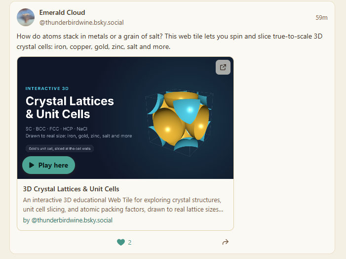

import LoopVideo from '../../components/LoopVideo.astro';

On Bluesky, a post can carry a picture or a video. In [Raku](https://raku.lexicographer.space/), a browser for web tiles, a post can carry a **tile**: a small live web app that you use right there in the post, without opening anything else.

<LoopVideo src="/blog/tile-posts/tile-posts-play.mp4" poster="/blog/tile-posts/tile-posts-play-poster.png" width={540} height={588} waitForPlay alt="A short clip of Raku's Tile posts. The list scrolls down past a few posts (a crystal tile, an @proto Colorado cube, a hiking trail map) and back up to the top, where a post by @thunderbirdwine.bsky.social reads “How do atoms stack in metals or a grain of salt? This web tile lets you spin and slice true-to-scale 3D crystal cells: iron, copper, gold, zinc, salt and more.” The pointer clicks Play here on the post's banner, the tile starts in place of the banner, and a 3D lattice of turquoise spheres appears. The pointer drags it, and the lattice turns and zooms, all inside the post." />

Try it: **[open Tile posts in Raku](https://raku.lexicographer.space/#t=raku%3Adiscover%2Fposts&a=0)** (in Raku: Discover, the compass, then Tile posts).

That's the whole idea. The rest of this post walks through what you can do with tile posts in Raku today, and then, for builders, how it works underneath: plain records in people's own accounts, which any app can read and write.

## Part 1: what you can do

### Tile posts

Tile posts lives in Raku's Discover, next to Tile news. Each has a line saying what it is:

- **Tile posts**: "Tiles shared as posts: each one is a live tile you can play right here. Posted from people's own accounts with Raku or the Foundry."
- **Tile news**: "What people are saying about web tiles across the Atmosphere: talk, links and news. From the Web Tiles feed."

Everyone's tile posts show there, newest first. Each one is the poster's few words, then the tile's card: its banner, its name, who made it and a line of its description.

### Play here, and expand

A tile post doesn't start by itself. Press **Play here** and the tile runs in place of its banner, inside the post. One tile plays at a time, and it stops when you scroll away from it. (If you'd rather they start as you scroll, there's an Autoplay switch in the Tile posts header, off unless you turn it on.)

When a post's tile is too small to enjoy, **Expand** gives it the whole of Raku's window:


× or Escape puts it back in the post. A tile with ways, like [the Escher maze and Winter Forest](https://thunderbird.cafe/blog/ways-portal-loop/), can even travel to another tile inside the same post, with "Back to …" to come back.

### Writing a tile post

To post a tile, press **Write a post** in Tile posts and choose one of your tiles, or press **Post** on a tile of yours that's open in a tab. Add a few words, or none:


The post is saved in your own account, not Raku's. Raku asks for that once, when you sign in: one permission, called **Raku**, which covers posting tiles, hearts, and Raku's games and rooms.

### Posting from the Foundry

[The Web Tile Foundry](https://foundry.thunderbird.cafe/), where you can make a tile without writing code, has the same step at the end. Once your tile is published, you can post it straight to Tile posts:


### A page for each post, and Share

Every tile post has its own page in Raku. Click a post's time (or **Open post** in its Share menu) to get there. **Share** gives you a link that opens just that post, or hands it to your device's own share sheet where there is one:


### Hearts

And you can give a post a heart. Tap it and it fills straight away, and the count goes up. Tap again to take it back:



Like the post itself, your heart is a small record in your own account. You don't need to sign in to see hearts, only to give one.

## Part 2: how it works

### Two small records

A tile post is a record of the kind `cafe.thunderbird.tile.post`, saved in the poster's own atproto account. It points at the tile by its address and its exact version (a `cid`), and carries the words, if any:

```json
{
  "$type": "cafe.thunderbird.tile.post",
  "tile": {
    "uri": "at://did:plc:joer5rzmwgec3dkr4srfmq45/ing.dasl.masl/3n22c4q7vxsrg",
    "cid": "bafyrei…"
  },
  "text": "How do atoms stack in metals or a grain of salt? …",
  "createdAt": "2026-11-12T…"
}
```

A heart is a record of the kind `cafe.thunderbird.tile.like`, the same shape as a Bluesky like: what it's for, and when.

```json
{
  "$type": "cafe.thunderbird.tile.like",
  "subject": {
    "uri": "at://did:plc:…/cafe.thunderbird.tile.post/…",
    "cid": "bafyrei…"
  },
  "createdAt": "2026-11-12T…"
}
```

Both lexicons are published from thunderbird.cafe's account, and they live in [the tile-posts repo](https://github.com/pyxorium/tile-posts) with a small script to write, list and delete tile posts. Raku and the Foundry are just two apps that write them. Any other app could read and write the same records.

### No server of Raku's own

Raku runs entirely in your browser, with no server of its own behind it. To find tile posts, it asks Bluesky's relay which accounts have any, then reads each account's posts from that account's own server. Accounts and tiles that moderation hides are left out.

Hearts are counted the same way: the relay names the accounts that have given hearts, Raku reads their hearts from their own servers, and counts each account once. Your own heart is read straight from your own account, so it's always right for you; other people see it within a few minutes. That's fine at today's size. If tile posts take off, a backlink index such as [Constellation](https://constellation.microcosm.blue/) could do the counting instead.
